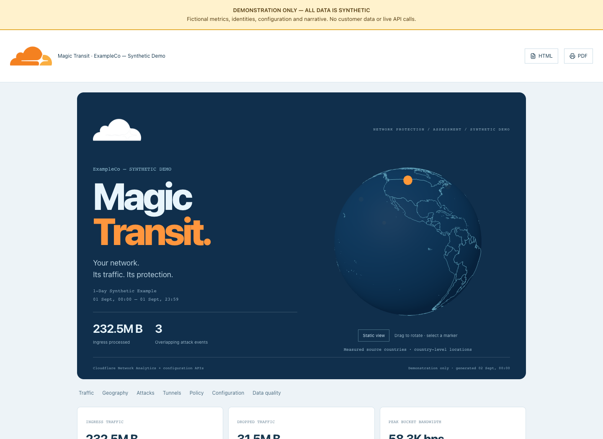
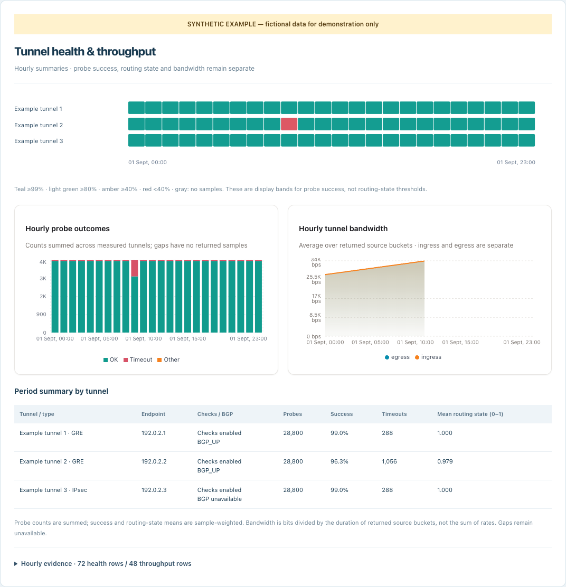
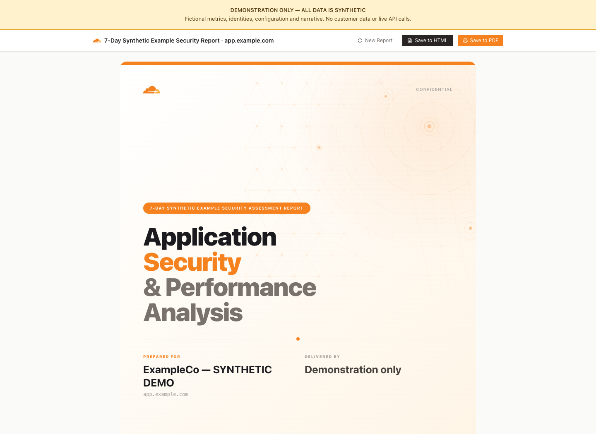
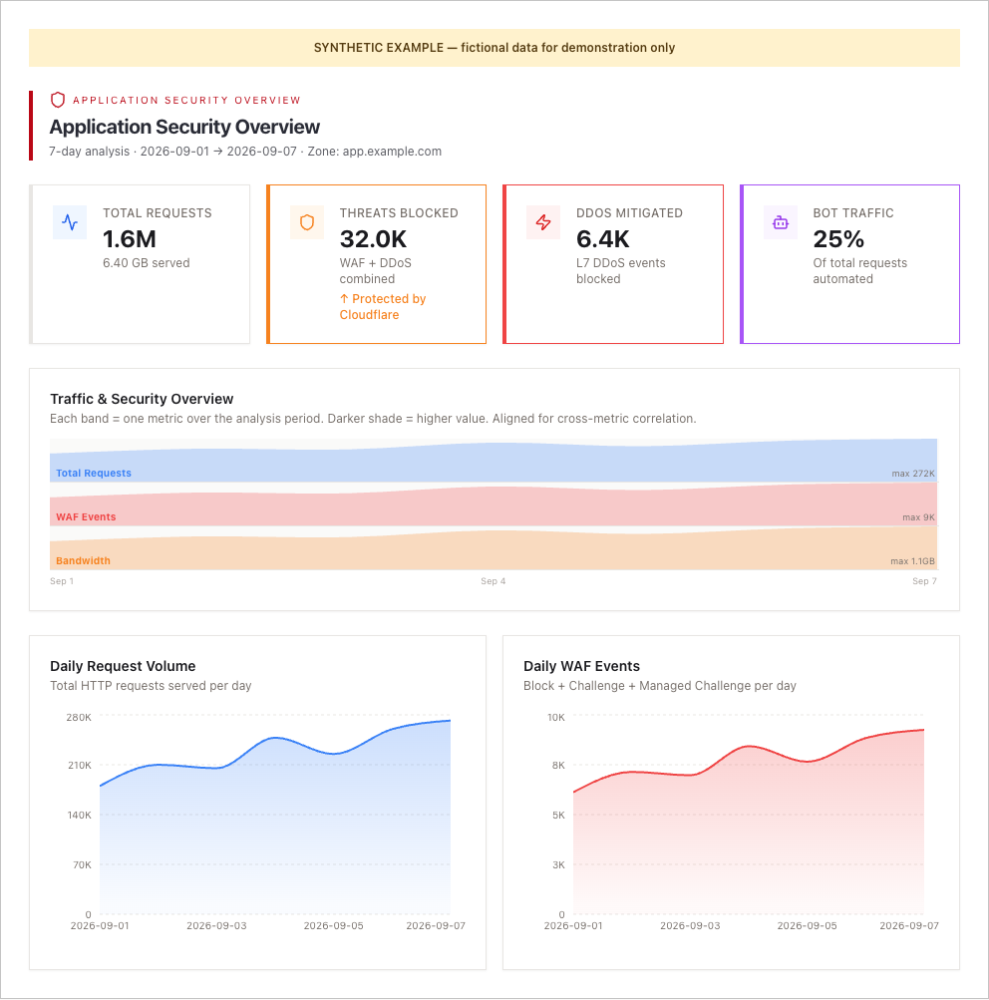
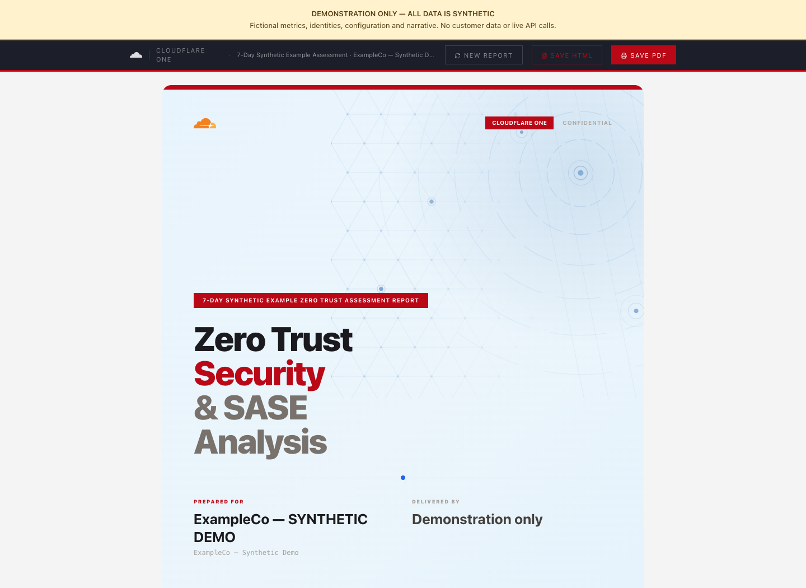
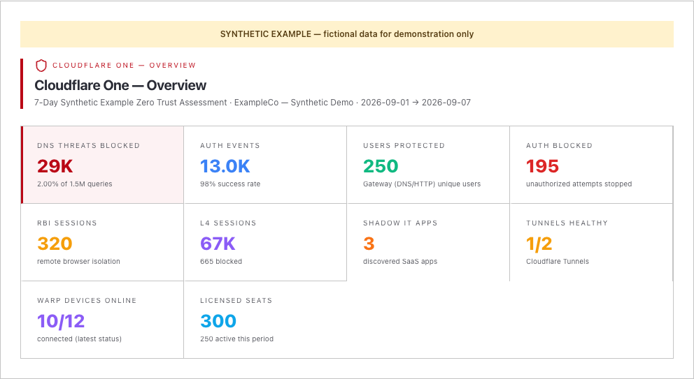

# Synthetic report examples

**Demonstration only: every metric, identity, configuration and narrative is
fictional. These are not customer reports, benchmarks or product-performance
claims. No live Cloudflare API or AI service is used to generate them.**

## Open the full reports

Download a file using GitHub's **Download raw file** button, then open it in a
browser. GitHub displays HTML source rather than executing the interactive
report. Each file bundles its charts, geography, styles and JavaScript and
works offline. Use the report's PDF button to print or save a PDF.

| Example | Full standalone HTML | Included views |
|---|---|---|
| AppSec | [appsec.html](appsec.html) | Traffic, geography, WAF/bots, caching, TLS, DNS and API traffic |
| Zero Trust / Cloudflare One | [zero-trust.html](zero-trust.html) | Access, Gateway, devices, tunnels and data-security activity |
| Magic Transit | [magic-transit.html](magic-transit.html) | Three.js globe, network traffic, attack events, hourly tunnel health/throughput and configuration |

Live actions and network requests are disabled in these examples. Identifiers
are clearly fictional, identities and domains use `example.com`, and IPs use
documentation or private address ranges. Narrative is illustrative, not
AI-generated. Incomplete sample coverage is labeled rather than asserted as
zero traffic.

## Screenshots

### Magic Transit




### AppSec




### Zero Trust / Cloudflare One




## Regenerate

Requires Node 22.13+ and a Playwright browser:

```bash
npm ci
npx playwright install chromium
npm run examples:check
npm run examples:build
# Or use an already-installed Chrome:
PLAYWRIGHT_CHANNEL=chrome npm run examples:build
```

Fixtures: [scripts/example-fixtures.ts](../scripts/example-fixtures.ts).
Generator: [scripts/render-examples.ts](../scripts/render-examples.ts).
The generator verifies offline rendering, browser errors and PDF output before
publication. Generated HTML intentionally includes the bundled application;
regenerate it when report templates change.
